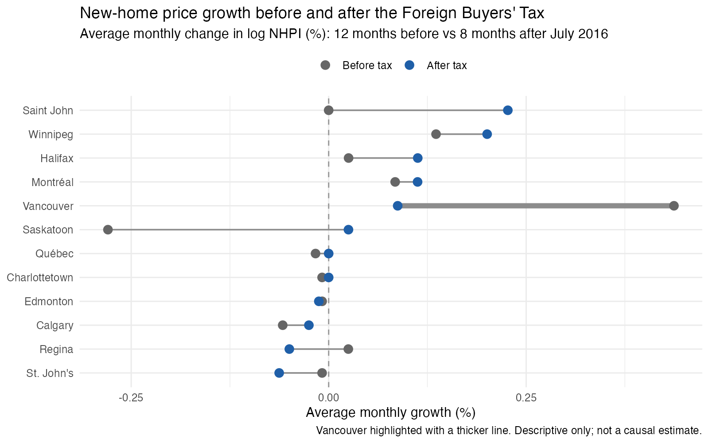
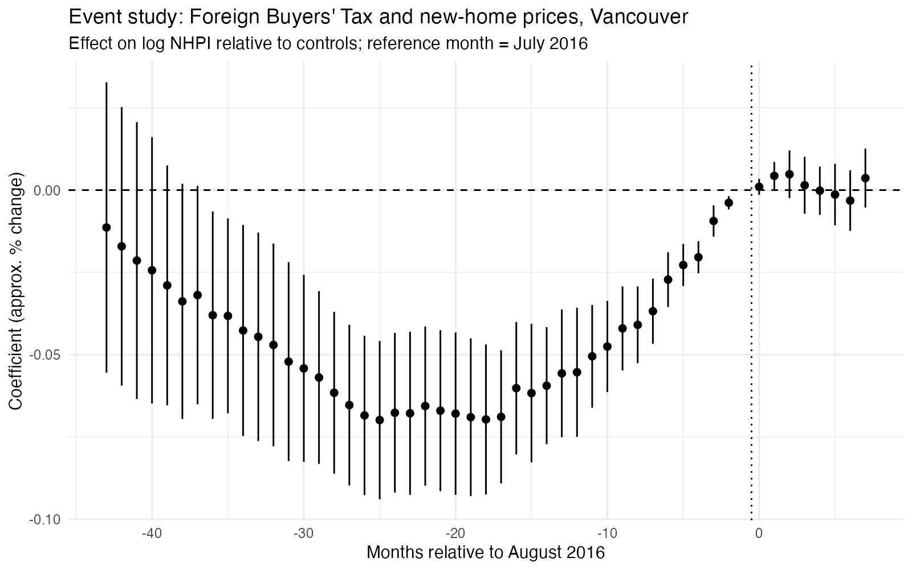
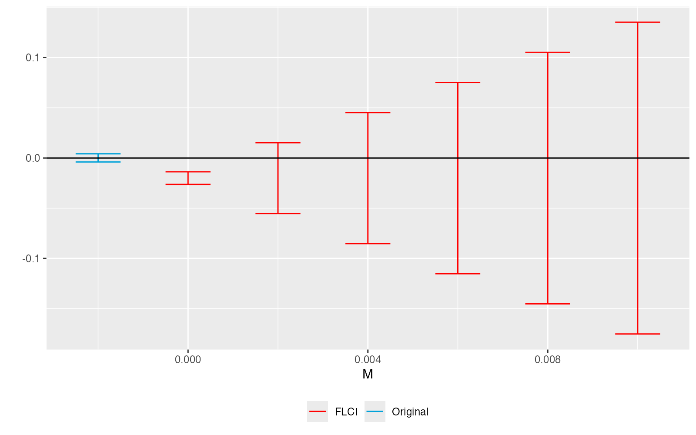

# Did BC's 2016 Additional Property Transfer Tax under Bill 28 (Miscellaneous Statutes (Housing Priority Initiatives) Amendment Act, 2016) change new-home prices in Vancouver?

This is a data project on a real policy question: did 2016 Additional Property Tax (Foreignt Tax) changed the home prices in Vancouver? 
Source: public Statistics Canada data.

On 2 August 2016, the government of British Columbia introduced a 15% additional property transfer tax on foreign buyers in Metro Vancouver. The stated goal was to manage foreign demand while new homes were built. The question: did new-home prices in Vancouver change relative to comparable cities that had no such tax?

## Key Objectives of the policy

1) Curb foreign demand: To deter foreign nationals, foreign corporations, and taxable trustees from treating local residential real estate as a speculative investment.
2) Cool quick price increases: To slow down the sharp, inflation-driven surge in home prices in high-demand regions like Metro Vancouver.
3) Fund housing initiatives: To channel tax revenues collected from foreign purchases directly into a Housing Priority Initiatives special account to support affordable housing, rentals, and support programs.
4) Discourage vacancies: When introduced via Bill 28, it also paved the way for municipal vacancy and empty homes taxes to push unused properties back into the long-term housing market.

## Important aspects that data shows

- Before the tax, the new home prices in Vancouver were rising much faster than other cities in Canada.
- After tax implementation, the increased slowed sharply which represented the biggest slowdown among 12 cities.
- There is a main fact for this analysis: Vancouver was already on a different path than other places before the tax.
- Prices were rising unusually fast before the tax, so a slowdown afterwards does not show that the tax caused it. The estimate is also too imprecise to tell: the interval runs from a large drop to a small rise.

I report this as an inconclusive result and explain the reasons why.

## What the data tell

**1. Vancouver was growing much faster than other cities, then slowed.**
Average monthly price growth in the 12 months before the tax versus the 8 months after. Vancouver (thick line) had the highest pace before and the largest slowdown after.



**2. The comparison cities were not a good match before the tax.**
Each dot is the gap between Vancouver and the controls, month by month, relative to July 2016. If the two had moved in parallel, the dots before the dotted line would be flat. They are not: Vancouver was catching up for most of 2015 and 2016.



**3. How sensitive is the result of the pre tax trend?**
The estimate assumes that Vancouver’s prices would have kept following their pre-tax trend without the tax. Each row of the table relaxes that assumption by a different amount. If the trend had continued in a straight line, the estimated effect of the tax is a small decline of about 1 to 3%. If the trend could have changed by as much as it did before the tax, the estimate would range from about -16% to +12%.



**4. Is Vancouver’s slowdown unusual compared with other cities?**
I applied the tax date to each of the other 11 cities in turn and measured the same slowdown in each. Vancouver’s is the largest of the 12, which is suggestive. But with only 12 cities, the smallest possible p-value is 0.083, so this test cannot reach conventional significance even when Vancouver ranks first.

Method: Difference in Differences (DiD)
DiD estimates the effect of a policy after it was introduced. I compare Vancouver’s price path with cities that did not get the tax, month by month, around the tax date.

Data: monthly New Housing Price Index (NHPI) from Statistics Canada, Table 18-10-0205-01, January 2013 to March 2017. It covers new homes, not resale.
Comparison cities: Calgary, Edmonton, Saskatoon, Regina, Winnipeg and Halifax. A robustness check extends this to 11 cities.
Why not a randomized experiment: the tax was introduced in one region, so I cannot assign it at random. DiD is the standard way to estimate an effect in this situation.

## Checks

| Check | Result |
|---|---|
| Drop Alberta (oil downturn in 2015-16) | Same pre-tax pattern |
| Extended set of 11 comparison cities | Same pre-tax pattern |
| Vancouver vs Victoria (descriptive) | Direction depends on which comparison city is used |
| Sensitivity to the pre-tax trend (HonestDiD) | Effect is negative only if the trend continues in a straight line; wide range otherwise |
| Placebo in space (12 cities) | Largest slowdown of the 12, p = 0.083 (the minimum possible); no difference in price level relative to July 2016 |

## Conclusions

Vancouver's price growth slowed after the tax more than in any comparison city, and the pre-tax trend was not parallel.

But it is not possible to establish that the tax lowered prices, or that it had no effect. Other things changed at the same time (for example the federal mortgage stress test in October 2016), there is one treated city, and the standard errors are unreliable with so few cities. The index also measures new-home prices only.

## Repository layout

```
R/
  01_download.R       download the NHPI table from Statistics Canada
  02_clean.R          build the analysis panels
  03_event_study.R    main event study
  04_raw_series.R     raw series and gap charts
  05_robustness.R     robustness checks and HonestDiD sensitivity
  06_data_quality.R   data quality flags and growth table
  07_dot_plot.R       before/after growth chart
  08_placebo_space.R  placebo in space
reports/report.qmd    full report
outputs/figures/      charts
```

## Full report

[Read the full report](https://luisalonso8.github.io/vancouver-foreign-buyers-tax/)

## Reproduce

Requires R (4.3 or later) and Quarto.

```r
install.packages(c("cansim", "dplyr", "lubridate", "stringr", "fixest", "broom",
                   "ggplot2", "remotes"))
remotes::install_github("asheshrambachan/HonestDiD")

source("R/01_download.R")
source("R/02_clean.R")
source("R/03_event_study.R")
source("R/05_robustness.R")
source("R/07_dot_plot.R")
source("R/08_placebo_space.R")
```

```
quarto render reports/report.qmd
```

## AI assistance

I used Claude as a coding assistant for this project, mainly for debugging R code. 

