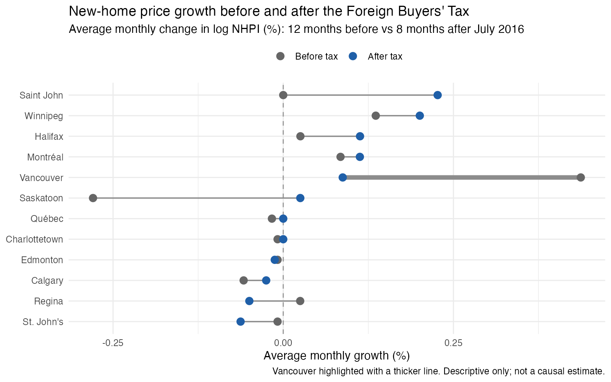
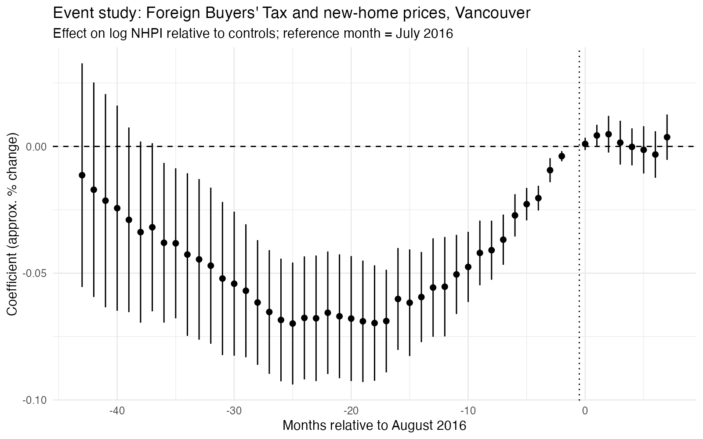
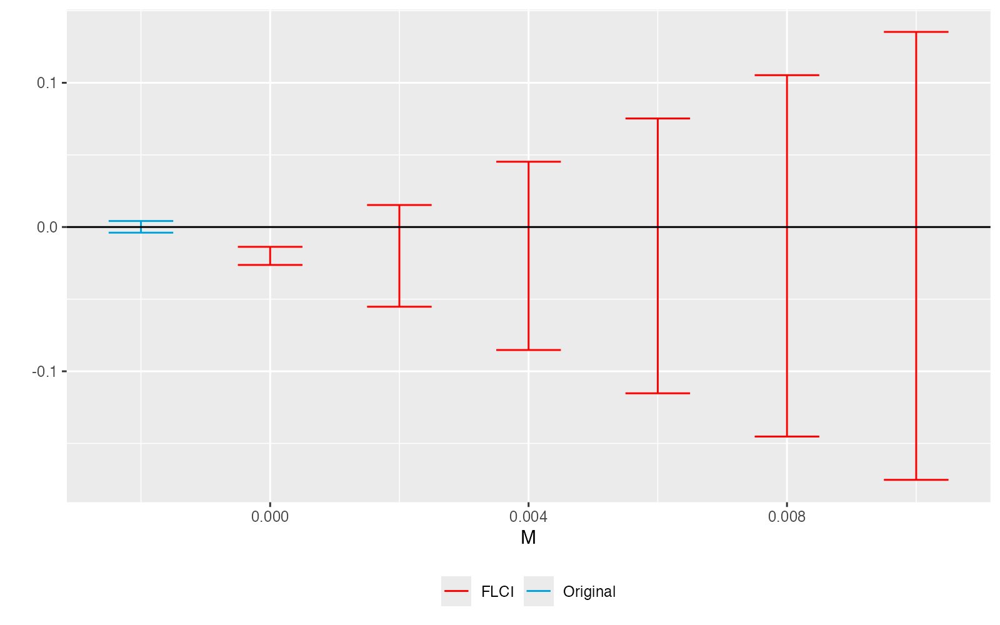
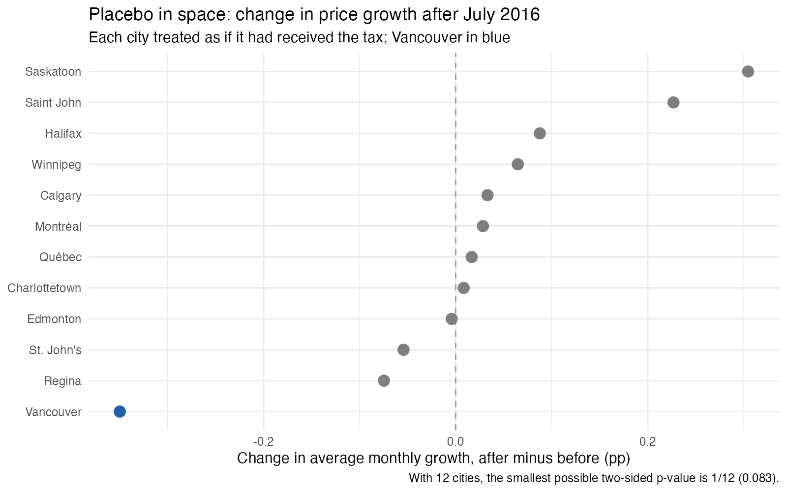

# Did BC's 2016 Foreign Buyers' Tax change new-home prices in Vancouver?

A small data project on a real policy question, using public Statistics Canada data and R.

## The short answer

**The data cannot tell.** Here is what they do show:

- Before the tax, new-home prices in Vancouver were rising much faster than in other Canadian cities.
- After the tax, that rise slowed sharply: the biggest slowdown among 12 cities.
- But Vancouver was already on a different path before the tax. A slowdown from an unusually fast pace is not the same as an effect of the tax, and the numbers are compatible with anything from a sizeable drop to a modest rise.

I report this as an inconclusive result and explain why, instead of forcing a headline.

## Background

On 2 August 2016, British Columbia introduced a 15% additional property transfer tax on foreign buyers in Metro Vancouver. The stated aim was to help manage foreign demand while new homes were built. The question here: did new-home prices in Vancouver change relative to comparable cities that had no such tax?

## What the data show

**1. Vancouver was growing much faster than other cities, then slowed.**
Average monthly price growth in the 12 months before the tax versus the 8 months after. Vancouver (thick line) had the highest pace before and the largest slowdown after.



**2. The comparison cities were not a good match before the tax.**
Each dot is the gap between Vancouver and the controls, month by month, relative to July 2016. If the two had moved in parallel, the dots before the dotted line would be flat. They are not: Vancouver was catching up for most of 2015 and 2016.



**3. How much does that matter?**
Each row asks: if Vancouver's pre-tax trend had bent by this much, what would the effect of the tax be? If the trend simply continued in a straight line, the tax looks like a small decline (about 1 to 3%). With the amount of bending seen in the data, the range runs from roughly -16% to +12%.



**4. Is Vancouver unusual compared with other cities?**
I pretended each of the other cities had received the tax and measured the same slowdown. Vancouver's is the largest, but with only 12 cities the smallest possible p-value is 0.083.



## How I approached it

- **Method:** difference-in-differences, in its event-study form. Vancouver's price path is compared with cities that did not get the tax, month by month, around the tax date.
- **Data:** monthly New Housing Price Index (NHPI), Statistics Canada, Table 18-10-0205-01. January 2013 to March 2017. It covers new homes, not resale.
- **Comparison cities:** Calgary, Edmonton, Saskatoon, Regina, Winnipeg and Halifax, extended to 11 cities in a robustness check.
- **Why not an A/B test:** the tax already happened in one region, so assignment cannot be randomized.

## What I checked

| Check | Result |
|---|---|
| Drop Alberta (oil downturn in 2015-16) | Same pre-tax pattern |
| Extended set of 11 comparison cities | Same pre-tax pattern |
| Vancouver vs Victoria (descriptive) | Direction depends on which comparison city is used |
| Sensitivity to the pre-tax trend (HonestDiD) | Effect is negative only if the trend continues in a straight line; wide range otherwise |
| Placebo in space (12 cities) | Largest slowdown of the 12, p = 0.083 (the minimum possible); no difference in price level relative to July 2016 |

## What this analysis can and cannot say

**It can say:** Vancouver's price growth slowed after the tax more than in any comparison city, and the pre-tax trend was not parallel.

**It cannot say:** that the tax lowered prices, or that it had no effect. Other things changed at the same time (for example the federal mortgage stress test in October 2016), there is one treated city, and the standard errors are unreliable with so few cities. The index also measures new-home prices only.

## Repository layout

```
R/
  01_download.R       download the NHPI table from Statistics Canada
  02_clean.R          build the analysis panels
  03_event_study.R    main event study
  04_raw_series.R     raw series and gap charts
  05_robustness.R     robustness checks and HonestDiD sensitivity
  06_data_quality.R   data quality flags and growth table
  07_dot_plot.R       before/after growth chart
  08_placebo_space.R  placebo in space
reports/report.qmd    full report
outputs/figures/      charts
```

## Full report

[Read the full report](https://luisalonso8.github.io/vancouver-foreign-buyers-tax/)

## Reproduce

Requires R (4.3 or later) and Quarto.

```r
install.packages(c("cansim", "dplyr", "lubridate", "stringr", "fixest", "broom",
                   "ggplot2", "remotes"))
remotes::install_github("asheshrambachan/HonestDiD")

source("R/01_download.R")
source("R/02_clean.R")
source("R/03_event_study.R")
source("R/05_robustness.R")
source("R/07_dot_plot.R")
source("R/08_placebo_space.R")
```

```
quarto render reports/report.qmd
```

## AI assistance

I used Claude  as a coding and methods assistant for this project, mainly for debugging R code. I made the design choices, ran all analyses, and am responsible for the results and conclusions.

