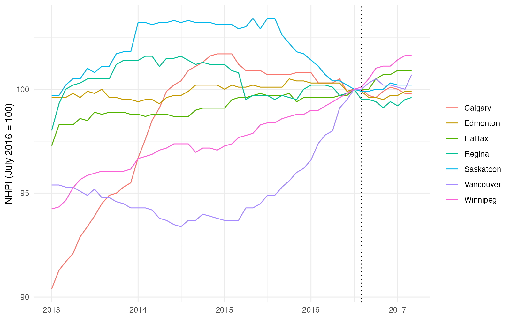

```{r}
#| include: false
library(knitr)
opts_chunk$set(echo = FALSE, message = FALSE, warning = FALSE)
```

## Summary

The available data cannot settle whether the 2016 Foreign Buyers' Tax (FBT) changed new-home prices in Vancouver. Before the tax, Vancouver's prices were rising much faster than in comparable Canadian cities. After it, that growth slowed more than in any of the 11 comparison cities. But the pre-tax trends were not parallel, which is the assumption the design relies on. Once the pre-tax trend is allowed to bend by as much as it did before the tax, the estimated effect ranges from roughly a 16% decline to a 12% increase. I therefore report an inconclusive result and document why.

## Question and hypothesis

On 2 August 2016, British Columbia introduced a 15% additional property transfer tax on foreign nationals and foreign corporations buying residential property in Metro Vancouver. It took effect with no transition period. The stated aim was to help manage foreign demand while new homes were being built.

**Question.** What was the effect of the FBT on new-home prices in Vancouver, relative to comparable Canadian metro areas that did not have the tax?

**Hypothesis.** The tax reduced demand from one group of buyers, so Vancouver's new-home prices should have grown more slowly (or fallen) relative to the control cities after August 2016. The null hypothesis is that Vancouver's price path relative to the controls did not change.

Builders set the prices measured here, which may adjust slowly, so an effect could appear with a lag.

## Data

- **Outcome.** The New Housing Price Index (NHPI) from Statistics Canada, table 18-10-0205-01 [@statcan_nhpi], monthly, by Census Metropolitan Area (CMA). The NHPI tracks what builders charge for new homes (house and land combined), with a fixed base period equal to 100. It does not measure resale prices.
- **Geography.** A CMA is Statistics Canada's definition of a metro area: a large city plus the surrounding municipalities that are economically tied to it.
- **Window.** January 2013 to March 2017: 51 months, 43 before the tax and 8 after. The window ends before Ontario introduced its own foreign buyers' tax in April 2017.
- **Treated unit.** Vancouver.
- **Controls.** Main specification: Calgary, Edmonton, Saskatoon, Regina, Winnipeg and Halifax. Robustness: Montréal, Québec, Saint John, Charlottetown and St. John's are added, giving 11 controls. Sherbrooke and Trois-Rivières were dropped because they have missing values in the window.
- **Excluded on purpose.** Ontario CMAs (own tax in April 2017). Victoria, because its proximity to Vancouver makes spillovers of displaced demand plausible; it is used only in a descriptive comparison. Kelowna has no valid data before December 2016 and was dropped.
- **Data quality.** Statistics Canada's status flags show no flagged observations for the main comparison cities in the window.

## Design

The tax applied to one region and cannot be randomized, so an A/B test is not possible. Difference-in-differences (DiD) is the closest quasi-experimental alternative: it compares Vancouver's change over time with the change in cities that had no tax over the same months, which removes anything common to all cities, such as interest rates and the national cycle [@roth2023].

I estimate an event study with two-way fixed effects (CMA and month):

$$\log(\text{NHPI}_{it}) = \alpha_i + \lambda_t + \sum_{k \neq -1} \beta_k \, \mathbb{1}[\text{rel\_month}_t = k] \times \text{Treated}_i + \varepsilon_{it}$$

There is one coefficient $\beta_k$ per month relative to the tax date, with July 2016 ($k=-1$) as the reference month. Using logs means the coefficients read as approximate percentage changes. Standard errors are clustered by CMA.

The identifying assumption is parallel trends: without the tax, Vancouver and the controls would have evolved in parallel. The pre-tax coefficients ($k<-1$) are the main evidence for or against it. With one treated unit and few controls, cluster-robust standard errors are unreliable [@bertrand2004], so I supplement them with a placebo test and a sensitivity analysis.

## Results

### Raw series

```{r}
#| out-width: 90%

```

Prices of each city rebased to 100 in July 2016. Vancouver rises faster than the controls for most of 2015 and 2016, and flattens around the tax date.

### Price growth before and after the tax

```{r}
#| out-width: 90%
include_graphics("../outputs/figures/dot_plot_growth.png")
```

```{r}
growth <- read.csv("../outputs/growth_dotplot.csv")
growth <- growth[order(-growth$after), c("cma", "before", "after", "change")]
names(growth) <- c("City", "Before tax (% per month)", "After tax (% per month)", "Change (pp)")
kable(growth, digits = 2, row.names = FALSE)
```

Vancouver grew at about 0.44% per month in the 12 months before the tax, the fastest in the sample (the next is Winnipeg at 0.14%). In the 8 months after, it grew at about 0.09% per month, ranking 5th of 12. Its slowdown (-0.35 percentage points per month) is the largest in the sample. This comparison is descriptive and uses only the endpoints of each series.

### Event study

```{r}
#| out-width: 90%
include_graphics("../outputs/figures/event_study_main.png")
```

The pre-tax coefficients are not flat: Vancouver's prices were catching up to the controls for most of 2015 and 2016. **Parallel trends does not hold.** After the tax, the coefficients are close to zero, and the confidence intervals include zero: the catch-up stopped, but there is no visible decline. The confidence intervals near the reference month are very narrow, which reflects the unreliable clustered standard errors rather than real precision.

### Sensitivity to the pre-tax trend

Because parallel trends fails, the sensitivity approach of @rambachan2023 was used. It asks which post-tax effects are consistent with a bounded departure from the pre-trend. The parameter $M$ is the maximum change in slope between consecutive periods: $M=0$ means the pre-trend would have continued in a straight line, and larger values allow it to bend. The target is the average effect over the 8 post-tax months.

```{r}
#| out-width: 90%
include_graphics("../outputs/figures/honest_did.png")
```

```{r}
sens <- read.csv("../outputs/honest_did_results.csv")
tab <- data.frame(M = sens$M, `Lower bound (%)` = 100 * sens$lb,
                  `Upper bound (%)` = 100 * sens$ub, check.names = FALSE)
kable(tab, digits = 1, row.names = FALSE)
```

If the pre-trend had continued in a straight line, the tax is associated with a decline of about 1.4% to 2.6%. With $M=0.002$ the interval already includes zero. The largest change in slope observed among the pre-tax coefficients is about 0.009. At that level the interval runs from roughly -16% to +12%.

### Placebo in space

I treated each of the 12 cities in turn as if it had received the tax and compared the same statistics.

```{r}
#| out-width: 90%
include_graphics("../outputs/figures/placebo_space.png")
```

```{r}
pl <- read.csv("../outputs/placebo_space.csv")
pl <- pl[order(pl$growth_change), c("cma", "growth_change", "post_coef")]
names(pl) <- c("City", "Change in monthly growth (pp)", "Avg. post-tax coefficient (%)")
kable(pl, digits = 2, row.names = FALSE)
```

By the change in monthly growth, Vancouver is the most extreme of the 12 cities (rank 1 of 12, two-sided p = 0.083, the smallest value attainable with 12 units). By the average post-tax coefficient, relative to July 2016, Vancouver is the closest to zero (p = 1.0): its price level relative to the controls stayed flat.

### Robustness

| Check | Result |
|---|---|
| Drop Alberta (oil downturn in 2015-16) | Same pre-tax pattern |
| Extended set of 11 control cities | Same pre-tax pattern |
| Vancouver vs Victoria (descriptive only) | Direction depends on which comparison city is used |
| Sensitivity to the pre-tax trend | Negative effect only under a near-linear pre-trend; wide range otherwise |
| Placebo in space | Largest slowdown of 12 cities (p = 0.083); no level difference vs July 2016 |

## Threats to validity or limitations

1. **Parallel trends fails.** This is the main limitation, and adding more controls does not fix it.
2. **Other events.** The federal mortgage stress test (October 2016) falls inside the post period and affects all cities, though not equally.
3. **Few clusters.** With one treated city and a handful of controls, clustered standard errors are unreliable, and the sensitivity intervals inherit this. The placebo test has a minimum p-value of 1/12.
4. **Mean reversion.** Vancouver had the fastest pre-tax growth, so it had the most room to slow down. No control city has a comparable run-up, so the placebo test cannot rule this out.
5. **Spillovers.** If the tax displaced demand into control cities, the estimated effect on Vancouver would be inflated rather than biased toward zero. Victoria was excluded for this reason.
6. **New housing only and a short window.** The NHPI measures builders' prices for new homes, and the post-tax window has 8 months.

## Conclusion

Vancouver's new-home price growth slowed after the tax more than in any comparison city, and its price level relative to the controls stopped rising. But Vancouver was already on a different path, so these data cannot separate the effect of the tax from the end of a pre-existing run-up. It is not possible to claim that the tax lowered prices, and that it had no effect.

**Future work.** A synthetic control or synthetic DiD could be tried, although Vancouver lies outside the range of the controls, so the pre-tax fit would be poor. A geographic regression discontinuity at the Metro Vancouver boundary would be a stronger design, but it requires property-level transaction data.

## References

::: {#refs}
:::
